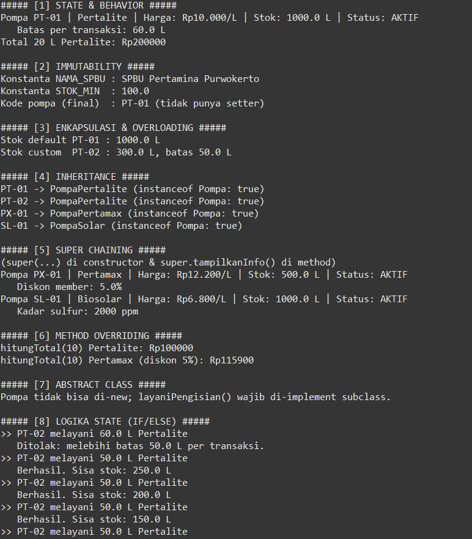

# Sistem SPBU - Responsi Akhir Praktikum PBO

## Identitas
- **Nama** : Raditya Firmansyah
- **NIM** : H1D025102
- **Tema** : SPBU (digit 2 dan 3)
- **Jurusan** : Informatika, Fakultas Teknik, Universitas Jenderal Soedirman

## Deskripsi Singkat
Simulasi pompa BBM di SPBU. `Pompa` adalah abstract class, dengan subclass
`PompaPertalite`, `PompaPertamax`, dan `PompaSolar`. Interface `Pembayaran`
dan `Laporan` dipakai untuk polimorfisme.

## Struktur File
| File | Keterangan |
|------|------------|
| `Pompa.java` | Abstract superclass |
| `PompaPertalite.java` | Subclass, implements `Pembayaran` |
| `PompaPertamax.java` | Subclass, implements `Pembayaran, Laporan` |
| `PompaSolar.java` | Subclass, implements `Pembayaran, Laporan` |
| `Pembayaran.java`, `Laporan.java` | Interface |
| `Main.java` | Pengujian 10 persyaratan |

## Cara Compile dan Run
```bash
javac *.java
java Main
```

## Screenshot Luaran


## Pemetaan Persyaratan
| No | Konsep | Lokasi |
|----|--------|--------|
| 1 | State & Behavior | `Pompa` (atribut, `tampilkanInfo()` void, `hitungPendapatan()` return) |
| 2 | Immutability | `NAMA_SPBU`, `STOK_MINIMAL` (static final), `kodePompa` (private final) |
| 3 | Enkapsulasi & Overloading | Atribut private + getter/setter, 2 constructor di tiap class |
| 4 | Inheritance | 3 subclass `extends Pompa`, `Main` terpisah |
| 5 | Super Chaining | `super(...)` di constructor, `super.tampilkanInfo()` |
| 6 | Overriding | `@Override` pada `layaniPengisian`, `hitungTotal`, `tampilkanInfo` |
| 7 | Abstract Class | `Pompa` + abstract `layaniPengisian()` |
| 8 | Logika State | if/else di `layaniPengisian()` baca & ubah stok/status |
| 9 | Polimorfisme Interface | `Pembayaran b = new PompaPertamax(...)` |
| 10 | Multiple Interface | `PompaPertamax`, `PompaSolar` implements `Pembayaran, Laporan` |
